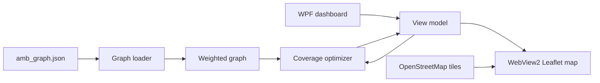

# Requirements

### Goal
Build the existing WPF application around `amb_graph.json` to explore greedy transit-access coverage in the Northern Corridor.

### Behavior
- Load the supplied graph on startup and treat every vertex as both a candidate site and a demand point.
- Let users select a walking-network radius from 50–500 m, defaulting to 500 m, and run optimization without freezing the interface.
- Display selected sites, covered and uncovered graph vertices on an interactive map, with clearly distinguishable markers and OpenStreetMap attribution.
- Report total vertices, selected sites, covered vertices and percentage, node reduction relative to selecting every vertex, and optimization time in milliseconds.
- Report input, optimization, or map initialization failures clearly; make map tile/network unavailability visible without preventing optimization.

### Boundaries
Greedy set cover is a heuristic, not a proof of minimum placement. Coverage is over graph vertices, not people; vertices are hypothetical sites, not verified stops. Road edges are modeled as undirected walking links as specified in the README, but the supplied data does not establish real-world pedestrian accessibility. Python extraction, population datasets, reports, and presentation materials are deferred.

# Technical Design

### Current implementation
`TranSmart.csproj` is a single `net10.0-windows` WPF application with no additional dependencies. `App.xaml` launches `MainWindow.xaml`; `MainWindow.xaml.cs` currently only initializes the window. `amb_graph.json` contains 852 nodes (`id`, `lat`, `lon`) and 1,920 edge records (`source`, `target`, `length`), including reciprocal edges and IDs exceeding 32-bit range.

### Design and contracts
- Deserialize with `System.Text.Json`, validating unique node IDs, finite coordinates, known edge endpoints, and finite nonnegative lengths. Use `long` IDs and a weighted adjacency list. Treat each record as undirected and retain the shortest length for duplicate or reciprocal endpoint pairs; isolated nodes remain valid. Copy the JSON to build and publish output and resolve it relative to `AppContext.BaseDirectory`.
- `GraphLoader.Load(path) -> Graph` returns an immutable indexed graph or a descriptive input error. Each vertex is its own candidate and demand point.
- `CoverageOptimizer.Optimize(Graph graph, double radiusMeters) -> CoverageResult` runs radius-bounded Dijkstra from each vertex using a priority queue, including the source and distances exactly at the radius. Cache only the resulting radius-limited neighborhoods for that run, rather than a full all-pairs distance matrix.
- Greedily select the candidate covering the most currently uncovered vertices; break ties by smallest node ID. Repeat until all vertices are covered, including disconnected and isolated vertices. `CoverageResult` contains selected IDs, covered IDs, total count, radius, and elapsed optimization milliseconds. Compute percentages from vertex counts, not population.
- `MainWindowViewModel` exposes radius, command availability, status, metrics and result state through WPF binding and change notifications. Run CPU work away from the UI thread, prevent overlapping runs, and marshal results back to the UI thread; validate radius and errors before updating the display.
- Add `Microsoft.Web.WebView2`; host a packaged Leaflet page using WebView2 virtual-host mapping. The view passes result coordinates and IDs as serialized JSON after the page is ready, replacing prior markers on each run. Keep Leaflet assets local; OpenStreetMap basemap tiles require internet, provider attribution, and appropriate tile-service usage. IDs crossing the JavaScript boundary should be strings to avoid precision loss.

### File structure
- Modify `TranSmart.csproj`, `TranSmart.slnx`, `MainWindow.xaml`, and `MainWindow.xaml.cs` for dependencies, deployment, dashboard, and map integration.
- Add `Models/Graph.cs`, `Models/CoverageResult.cs`, `Services/GraphLoader.cs`, `Services/CoverageOptimizer.cs`, and `ViewModels/MainWindowViewModel.cs`.
- Add `Map/index.html` and packaged Leaflet assets; copy them to output with the graph.
- Add `Tests/TranSmart.Tests.csproj` and focused graph/optimizer tests. Exclude `Tests/**/*.cs` from the main project's default compile glob.

### Architecture

### Risks
WebView2 Runtime must be installed; show an actionable error if unavailable. Internet loss affects external map tiles, not graph loading or optimization. Avoid implying that point markers or straight-line display represent the shape of walking neighborhoods; the JSON has no edge geometry.

# Testing

### Automated validation
- Add unit tests for JSON parsing, 64-bit IDs, unknown endpoints, duplicate IDs, invalid lengths, reciprocal/parallel edge normalization, and isolated nodes.
- Verify radius-bounded Dijkstra on a weighted graph where the shortest path differs from the direct edge; test the exact-radius boundary and disconnected components.
- Verify greedy choices, stable tie-breaking, complete coverage, and metrics on small graphs with known results; include a case demonstrating that greedy need not be optimal.
- Load the supplied graph in an integration test, assert its node and edge-record counts, run at representative radii including 500 m, and independently verify every vertex is within the chosen radius of a selected site.
- Build the solution and exercise the WPF flow: radius changes, repeated runs, busy/error states, map marker replacement, metrics, and missing graph or map runtime. Confirm the application still optimizes when basemap tiles are unavailable.

# Delivery Steps

### ✓ Step 1: Load and validate the supplied road graph
The application can construct a valid undirected graph from the bundled dataset.

- Add graph models and a JSON loader using 64-bit node IDs and weighted adjacency lists.
- Validate input, normalize reciprocal and parallel records, and retain isolated nodes.
- Package `amb_graph.json` for build and publish output.
- Add focused loader tests and a supplied-data integration check.

### ✓ Step 2: Implement radius-based greedy coverage
The optimization engine returns deterministic graph-node coverage for a chosen radius.

- Implement bounded Dijkstra and per-run radius neighborhoods using nonnegative edge lengths.
- Implement greedy set cover with a stable node-ID tie-break and elapsed-time measurement.
- Calculate selected, covered, and reduction metrics without claiming population coverage or mathematical optimality.
- Test weighted paths, radius boundaries, disconnected graphs, greedy behavior, and full coverage of the supplied graph.

### ✓ Step 3: Build the responsive WPF dashboard
Users can choose a radius and run the optimizer while viewing accurate metrics and status.

- Add `MainWindowViewModel` with bindable radius, commands, results, busy state, and errors.
- Update `MainWindow.xaml` and its code-behind to bind the controls and start graph loading and optimization without blocking the UI.
- Handle missing or invalid graph data and prevent overlapping runs.
- Verify repeated runs, status transitions, and displayed metrics.

### ✓ Step 4: Render results on an interactive map
The dashboard visualizes selected and covered vertices in WebView2.

- Add WebView2 and a packaged Leaflet page with OpenStreetMap attribution and tiles.
- Send serialized coordinates and string IDs only after the map is initialized, and replace markers on subsequent results.
- Show actionable WebView2 errors and tile-unavailable status without blocking optimization.
- Verify map rendering, repeated updates, offline tile behavior, and build/publish asset availability.